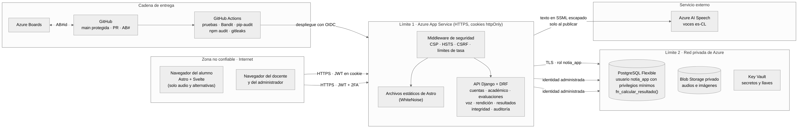

# NotIA · Arquitectura

Especificación técnica del sistema NotIA para AulaConecta (Desarrollo Seguro CI3V64, INACAP). Es la fuente de verdad para el equipo y para Claude Code: modelo de datos, reglas de negocio, API, seguridad, privacidad, frontend, pruebas y CI/CD. El orden de trabajo (fases, PR y commits) está en `docs/PLAN_DESARROLLO.md`. Si algo de este documento cambia, se actualiza en el mismo PR que introduce el cambio.

---

## 2. Contexto y alcance

**Problema.** El colegio necesita que sus alumnos rindan pruebas sin ayuda de inteligencia artificial, que los datos de los estudiantes (menores de edad, de básica y media) estén protegidos según la Ley 21.719, y que cada docente pueda elegir la modalidad de prueba de cada alumno para que ninguno quede excluido.

**Solución.** NotIA es una prueba de alternativas en la que **la pregunta solo se escucha**. En pantalla aparecen únicamente las alternativas y un temporizador por pregunta. El alumno elige la voz que lee las preguntas, puede repetir el audio cuantas veces quiera mientras dure el tiempo, y puede pasar una pregunta; las preguntas pasadas vuelven al final con el tiempo que les quedaba. El docente crea las pruebas y asigna a cada alumno la modalidad NotIA o la modalidad normal (pregunta escrita). El texto de la pregunta y la respuesta correcta nunca viajan al navegador del alumno en modalidad NotIA, y el tiempo lo controla el servidor.

**Usuarios.** Alumno, Docente y Administrador (equipo directivo).

**Fuera de alcance.** Portal de notas, asistencia, justificativos e informes para apoderados. Aplicación móvil. Correo electrónico (no hay envío de correos; las contraseñas las restablece el administrador).

**Supuestos.** Las pruebas se rinden en la sala, en los computadores del colegio, con audífonos y en Chrome, Edge o Firefox de escritorio. Se esperan hasta 400 alumnos rindiendo al mismo tiempo.

**Limitaciones aceptadas** (deben quedar escritas en la documentación, no se intenta resolverlas con trucos):
- Una página web no puede impedir capturas de pantalla ni que alguien grabe el audio con otro dispositivo. Se mitiga con marca de agua con el nombre del alumno, registro de eventos y supervisión en sala.
- La detección de capturas es parcial: se detecta la tecla Imprimir Pantalla en algunos navegadores y la pérdida de foco que provoca la herramienta Recortes, pero no un celular.
- No se usan detectores de texto generado por IA, cámaras ni biometría.

### 2.1 Casos de uso (con título)

| ID | Caso de uso | Actor | Fase |
|---|---|---|---|
| CU-01 | Iniciar sesión con límite de intentos | Todos | 1 |
| CU-02 | Verificar segundo factor (2FA) | Docente, Admin | 1 |
| CU-03 | Cerrar sesión | Todos | 1 |
| CU-04 | Cambiar contraseña | Todos | 1 |
| CU-05 | Rendir prueba NotIA | Alumno | 2 |
| CU-06 | Rendir prueba en modalidad normal | Alumno | 2 |
| CU-07 | Elegir y cambiar la voz | Alumno | 2 |
| CU-08 | Avisar al docente (ninguna voz sirve / necesito otra modalidad) | Alumno | 2 |
| CU-09 | Crear, editar y versionar una evaluación | Docente | 3 |
| CU-10 | Publicar una evaluación (genera audios) | Docente | 3 |
| CU-11 | Asignar modalidad por alumno | Docente | 3 |
| CU-12 | Revisar alertas e intentos | Docente | 3 |
| CU-13 | Revisar resultados, anular o corregir preguntas y publicar notas | Docente | 3 |
| CU-14 | Reabrir un intento interrumpido | Docente | 3 |
| CU-15 | Gestionar usuarios, cursos y consentimientos | Admin | 4 |
| CU-16 | Consultar la bitácora de auditoría | Admin | 4 |
| CU-17 | Exportar o anonimizar los datos de un alumno | Admin | 4 |

CU-01 y CU-05 son los casos que el ramo evalúa en código; deben quedar impecables y con más pruebas que el resto.

---

## 3. Stack y versiones

Usa la versión estable más reciente de cada componente que sea compatible con el resto, y fija versiones exactas.

**Backend** (`backend/`)
- Python 3.12, Django 5.2 LTS, Django REST Framework.
- `djangorestframework-simplejwt` con lista negra de tokens (`token_blacklist`).
- `psycopg` 3 (con el pool de conexiones nativo de Django), `argon2-cffi`, `pyotp`, `segno` (QR en SVG), `cryptography` (Fernet), `Pillow`, `django-storages[azure]`, `azure-identity`, `httpx` (para Azure Speech por REST), `whitenoise`, `gunicorn`.
- Desarrollo y pruebas: `pytest`, `pytest-django`, `pytest-cov`, `time-machine`, `factory-boy`, `ruff`, `bandit`, `pip-audit`, `pip-tools`, `pre-commit`, `locust`.
- Dependencias en `requirements/*.in` compiladas con `pip-compile --generate-hashes` a `requirements/*.txt`.

**Frontend** (`frontend/`)
- Astro con `output: 'static'` (sin SSR), TypeScript estricto e islas en **Svelte 5** (`@astrojs/svelte`).
- Fuentes autoalojadas con paquetes `@fontsource/*` (nada de CDN externos, por la CSP).
- ESLint con `eslint-plugin-svelte` y `eslint-plugin-security`, `svelte-check`/`astro check` y Vitest para la lógica de `src/lib`.
- Sin librerías de componentes de UI. Los estilos son propios (CSS con variables).

**Infraestructura**
- PostgreSQL 16 o superior. En local se levanta con `docker compose`; en Azure se usa Azure Database for PostgreSQL Flexible Server.
- Azure App Service (Linux, Python) sirve la API y los archivos estáticos de Astro desde el mismo dominio.
- Azure Blob Storage (contenedor privado), Azure Key Vault y Azure AI Speech.
- GitHub (repositorio), GitHub Actions (CI/CD) y Azure Boards (planificación, enlazado con `AB#`).

---

## 4. Estructura del repositorio

```
aulaconecta-notia/
├── backend/
│   ├── manage.py
│   ├── config/
│   │   ├── settings/ (base.py, dev.py, test.py, prod.py)
│   │   ├── urls.py, wsgi.py, asgi.py
│   ├── apps/
│   │   ├── core/          # permisos, errores, middleware de cabeceras, utilidades, validación de imágenes
│   │   ├── cuentas/       # Usuario, login, JWT en cookies, 2FA, bloqueo, contraseñas
│   │   ├── academico/     # Curso, CursoDocente, Matricula
│   │   ├── evaluaciones/  # Evaluacion, Pregunta, Alternativa, AsignacionPrueba, versiones, publicación
│   │   ├── voz/           # proveedores de voz, AudioPregunta, voces disponibles
│   │   ├── rendicion/     # Intento, Respuesta, motor de tiempo, endpoints del alumno
│   │   ├── resultados/    # Resultado, función SQL de corrección, notas, exportación CSV
│   │   ├── integridad/    # EventoIntegridad, SolicitudAlumno, alertas al docente
│   │   └── auditoria/     # RegistroAuditoria (bitácora)
│   ├── db/                # roles.sql (roles de PostgreSQL) y permisos/base_de_datos.sql (permisos dentro de la base)
│   ├── conftest.py        # prepara la base de pruebas con los tres roles (sección 15)
│   ├── requirements/ (base.in, dev.in, base.txt, dev.txt)
│   ├── tests/carga/       # locustfile.py
│   └── pyproject.toml     # ruff, pytest, bandit
├── frontend/
│   ├── astro.config.mjs
│   ├── src/
│   │   ├── pages/         # rutas (sección 14)
│   │   ├── components/    # islas .svelte y componentes .astro
│   │   ├── layouts/
│   │   ├── lib/           # api.ts, sesion.ts, integridad.ts, tipos.ts
│   │   └── styles/
│   └── scripts/           # hash-csp.mjs (sección 12.2)
├── docs/                  # ARQUITECTURA.md, PLAN_DESARROLLO.md, TRAZABILIDAD.md, PRIVACIDAD.md, diagramas/, informes PDF
├── .github/
│   ├── workflows/ (ci.yml, deploy.yml)
│   ├── dependabot.yml
│   └── pull_request_template.md
├── docker-compose.yml     # solo PostgreSQL para desarrollo (lee sus contraseñas de backend/.env)
├── .gitignore, .editorconfig, .pre-commit-config.yaml, .gitleaks.toml
├── README.md, SECURITY.md, CLAUDE.md
```

---

## 5. Arquitectura y límites de confianza

```
[Navegador alumno/docente/admin]  ← zona NO confiable
        │ HTTPS (TLS 1.2+), cookies httpOnly + CSRF
        ▼
[Azure App Service] ← límite 1
  ├─ Middleware de seguridad (CSP, HSTS, cabeceras, límites de tasa)
  ├─ Archivos estáticos de Astro servidos por WhiteNoise (mismo origen que la API)
  └─ API Django /api/*  (única pieza que toma decisiones)
        │ TLS, rol notia_app            │ identidad administrada
        ▼                               ▼
[PostgreSQL Flexible]  [Blob Storage privado]  [Key Vault]   ← límite 2 (red privada)

[Azure AI Speech] ← servicio externo; solo recibe el texto de las preguntas al publicar
[GitHub → GitHub Actions → despliegue con OIDC]; [Azure Boards ↔ GitHub con AB#]
```



Decisiones:
- **Mismo origen.** Django sirve el build de Astro con WhiteNoise (`WHITENOISE_ROOT` apuntando al `dist` copiado en el despliegue) y la API bajo `/api/`. Así las cookies pueden ser `SameSite=Strict`, no hay CORS y no se necesita un segundo servicio. En desarrollo, el servidor de Astro (puerto 4321) redirige `/api` a Django (puerto 8000) con el proxy de Vite, para conservar el mismo origen.
- **El servidor es la única fuente de verdad** para permisos, tiempo, corrección y notas.
- **Archivos privados.** Audios e imágenes se guardan en almacenamiento privado (sistema de archivos fuera de `static` en local; Blob privado en Azure) y solo se entregan a través de endpoints autenticados de Django. Nunca hay URLs públicas ni adivinables.
- **Sin colas ni jobs.** Lo que en otro sistema haría un job (cerrar intentos vencidos, por ejemplo) se resuelve de forma perezosa: cada petición que toca un intento o una evaluación primero sincroniza su estado según la hora del servidor.

---

## 6. Modelo de datos

Todas las tablas expuestas por la API usan UUID como identificador público. Usa `TextChoices` para los estados. Agrega índices y restricciones (`UniqueConstraint`, `CheckConstraint`) donde se indica.

**cuentas**
- `Usuario` (modelo propio con `AbstractBaseUser` y `PermissionsMixin`; `AUTH_USER_MODEL`; se crea en la Fase 0, antes de la primera migración, y se completa en la Fase 1): `id` UUID; `correo` único (se guarda en minúsculas; dominio institucional configurable por variable de entorno); `nombres`; `apellidos`; `rol` (ALUMNO, DOCENTE, ADMIN); `is_active`; `debe_cambiar_password`; `intentos_fallidos`; `bloqueado_hasta`; `version_sesion` (entero, se incrementa para invalidar todas las sesiones); `mfa_habilitado`; `mfa_secreto_cifrado` (Fernet); `mfa_ultimo_paso` (contra repetición de códigos TOTP); `voz_preferida`; `consentimiento_verificado_en`; `consentimiento_verificado_por` (FK a admin); `creado_en`; `ultimo_acceso`.
- `CodigoRecuperacion`: `usuario`, `codigo_hash` (Argon2), `usado_en`.
- **No se guarda**: RUT, fecha de nacimiento, dirección, teléfono, datos de salud, discapacidad ni motivo alguno de la modalidad.

**academico**
- `Curso`: `id`, `nombre` (ej. "2° Medio A"), `anio`, `activo`. Único por (`nombre`, `anio`).
- `CursoDocente`: `curso`, `docente`, `asignatura`. Único por (`curso`, `docente`, `asignatura`).
- `Matricula`: `curso`, `alumno`, `activa`. Único por (`curso`, `alumno`).

**evaluaciones**
- `Evaluacion`: `id`; `curso`; `creada_por` (docente); `titulo`; `instrucciones`; `asignatura`; `estado` (BORRADOR, PUBLICADA, CERRADA); `version` (entero); `evaluacion_origen` (FK opcional a la versión anterior); `inicio` y `fin` (ventana en que se puede rendir); `exigencia` (porcentaje, por defecto 60); `nota_minima` (1.0), `nota_maxima` (7.0); `aleatorizar_preguntas` y `aleatorizar_alternativas` (por defecto verdaderos); `publicada_en`; `creada_en`. Una evaluación publicada no se edita: se crea una nueva versión (copia en BORRADOR con `version + 1`).
- `Pregunta`: `id`; `evaluacion`; `orden`; `texto` (máx. 1.000 caracteres); `tiempo_segundos` (entre 10 y 300); `puntaje` (por defecto 1); `imagen` (opcional, ruta privada); `anulada`.
- `Alternativa`: `id`; `pregunta`; `orden`; `texto` (máx. 300); `es_correcta`. Entre 2 y 6 por pregunta y exactamente una correcta (se valida al guardar y al publicar).
- `AsignacionPrueba`: `evaluacion`; `alumno`; `modalidad` (NOTIA, NORMAL; por defecto NOTIA); `asignada_por`; `asignada_en`. Único por (`evaluacion`, `alumno`). **No tiene campo de motivo** (ver sección 13).

**voz**
- `AudioPregunta`: `pregunta`; `voz`; `archivo` (ruta privada con nombre aleatorio); `hash_contenido` (SHA-256 de voz + texto, para no regenerar); `bytes`; `generado_en`. Único por (`pregunta`, `voz`).
- `AudioMuestra`: un audio corto de ejemplo por voz ("Hola, esta es la voz que leerá tus preguntas"), para que el alumno elija sin escuchar preguntas reales.
- Las voces disponibles se configuran por variable de entorno; por defecto `es-CL-CatalinaNeural` y `es-CL-LorenzoNeural`.

**rendicion**
- `Intento`: `id`; `evaluacion`; `alumno`; `modalidad` (copia de la asignación al iniciar); `voz`; `estado` (EN_CURSO, FINALIZADO, EXPIRADO); `ronda` (1 = preguntas en orden, 2 = preguntas pasadas); `iniciado_en`; `finalizado_en`; `reabierto_en`; `reabierto_por`. Único por (`evaluacion`, `alumno`).
- `Respuesta` (un registro por pregunta del intento, se crean todos al iniciar): `id`; `intento`; `pregunta`; `orden_presentacion`; `orden_alternativas` (lista de UUID ya barajada); `estado` (NO_VISTA, EN_CURSO, PASADA, RESPONDIDA, SIN_TIEMPO); `segundos_usados` (decimal acumulado); `presentada_en` (inicio del tramo actual, nulo si no está en curso); `alternativa` (FK opcional); `respondida_en`; `repeticiones_audio`. Único por (`intento`, `pregunta`).

**resultados**
- `Resultado`: `asignacion` (uno a uno con `AsignacionPrueba`); `intento` (opcional); `puntaje_obtenido`; `puntaje_total`; `porcentaje`; `nota` (decimal 2,1, opcional); `estado` (PENDIENTE, CALCULADO, SIN_NOTA, PUBLICADO); `calculado_en`; `publicado_en`. Un alumno que no rindió queda en PENDIENTE y **nunca** recibe una nota automática; el docente puede marcarlo SIN_NOTA.

**integridad**
- `EventoIntegridad`: `intento`; `respuesta` (opcional); `tipo` (SALIO_DE_PESTANA, VOLVIO_A_PESTANA, PERDIO_FOCO, RECUPERO_FOCO, SALIO_DE_PANTALLA_COMPLETA, INTENTO_COPIAR, INTENTO_CORTAR, INTENTO_PEGAR, CLIC_DERECHO, TECLA_IMPRIMIR_PANTALLA, RECONEXION); `duracion_ms` (opcional); `registrado_en` (hora del servidor); `revisado`.
- `SolicitudAlumno`: `alumno`; `evaluacion`; `tipo` (NINGUNA_VOZ_SIRVE, NECESITO_OTRA_MODALIDAD); `estado` (PENDIENTE, ATENDIDA); `creada_en`; `atendida_por`. **Sin texto libre**, para que el alumno no escriba datos de salud.

**auditoria**
- `RegistroAuditoria` (bitácora): `id` (bigint); `ocurrido_en`; `actor` (opcional); `rol_actor`; `accion` (ver lista); `objeto_tipo`; `objeto_id`; `ip`; `user_agent` (recortado a 200 caracteres); `detalle` (JSON). Solo se inserta y se lee: el rol de base de datos de la aplicación no tiene UPDATE ni DELETE sobre esta tabla.
- Acciones mínimas: LOGIN_OK, LOGIN_FALLIDO, CUENTA_BLOQUEADA, CUENTA_DESBLOQUEADA, MFA_OK, MFA_FALLIDO, MFA_ACTIVADO, MFA_REINICIADO, LOGOUT, PASSWORD_CAMBIADA, PASSWORD_RESTABLECIDA, ACCESO_DENEGADO, USUARIO_CREADO, USUARIO_MODIFICADO, USUARIO_DESACTIVADO, CONSENTIMIENTO_REGISTRADO, EVALUACION_CREADA, EVALUACION_PUBLICADA, EVALUACION_VERSIONADA, EVALUACION_CERRADA, MODALIDAD_ASIGNADA, INTENTO_INICIADO, INTENTO_FINALIZADO, INTENTO_REABIERTO, PREGUNTA_ANULADA, CORRECCION_MODIFICADA, NOTAS_PUBLICADAS, DATOS_EXPORTADOS, ALUMNO_ANONIMIZADO, DATOS_PURGADOS.
- **Nunca** se guarda en la bitácora: contraseñas (ni fallidas), tokens, códigos 2FA, alternativas elegidas ni texto de preguntas.

---

## 7. Motor de rendición (CU-05, CU-06 y CU-07)

### 7.1 Reglas

1. El alumno solo puede iniciar si tiene una asignación para la evaluación, la evaluación está PUBLICADA, la hora del servidor está dentro de [`inicio`, `fin`] y no tiene un intento previo.
2. Al iniciar se crean todas las `Respuesta` con orden de preguntas y de alternativas barajado (si la evaluación lo indica) usando `secrets.SystemRandom`.
3. Se presenta **una pregunta a la vez**. El tiempo de cada pregunta corre en el servidor desde `presentada_en`.
4. **Ronda 1:** preguntas NO_VISTA en orden. **Ronda 2:** preguntas PASADA a las que les queda tiempo, en orden. Cuando no queda ninguna, el intento se finaliza solo.
5. **Pasar:** suma el tramo a `segundos_usados`, deja la pregunta en PASADA y vuelve en la ronda 2 **con el tiempo que le quedaba**. En la ronda 2 se puede volver a pasar mientras quede tiempo.
6. **Responder:** solo la pregunta EN_CURSO, solo con una alternativa de esa pregunta y solo si el tiempo no se agotó (con 2 segundos de tolerancia por latencia, configurable). Una respuesta dada no se cambia.
7. **Tiempo agotado:** la pregunta pasa a SIN_TIEMPO y se presenta la siguiente.
8. **Desconexión:** el tiempo sigue corriendo en el servidor. Al volver, el alumno retoma donde corresponda según la hora del servidor. Las respuestas ya enviadas quedan guardadas desde el momento en que se envían.
9. **Reapertura (CU-14):** el docente puede reabrir un intento interrumpido. Elige qué preguntas no respondidas (SIN_TIEMPO, PASADA o NO_VISTA) se rehabilitan; estas vuelven con su tiempo completo. Se registra en la bitácora con el docente y las preguntas afectadas.
10. **Fin de la ventana:** si la hora del servidor supera `fin`, el intento se finaliza (EXPIRADO) en la siguiente petición que lo toque, y también cuando el docente abre los resultados.
11. **Voz:** el alumno elige la voz antes de empezar (con audios de muestra) y puede cambiarla en cualquier momento; el audio de la pregunta actual se vuelve a pedir con la nueva voz sin reiniciar el tiempo.
12. **Repetir audio:** el navegador reproduce de nuevo el audio ya descargado. Cada repetición se informa al servidor solo para contarla (`repeticiones_audio`).
13. **Modalidad NORMAL:** el mismo flujo, pero la respuesta de la API incluye el texto de la pregunta y no hay audio.
14. Al finalizar se llama a la función SQL de corrección (sección 9) y se crea o actualiza el `Resultado` en estado CALCULADO. El alumno ve su nota solo cuando el docente la publica.
15. Todas las operaciones que cambian el estado de un intento usan una transacción con `select_for_update()` sobre el intento, para evitar condiciones de carrera (por ejemplo, dos pestañas respondiendo a la vez).

### 7.2 Qué recibe el navegador del alumno

`GET /api/alumno/intentos/{id}/actual` devuelve, por ejemplo:

```json
{
  "estado": "EN_CURSO",
  "modalidad": "NOTIA",
  "ronda": 1,
  "pregunta": {
    "ref": "uuid-de-la-respuesta",
    "numero": 3,
    "total": 20,
    "tiempo_total_ms": 60000,
    "restante_ms": 41200,
    "alternativas": [{ "id": "uuid", "letra": "A", "texto": "Una manzana" }],
    "audio_url": "/api/alumno/respuestas/uuid/audio",
    "imagen_url": null,
    "texto": null
  }
}
```

- En NOTIA, `texto` siempre es `null`. **Nunca** se envían `es_correcta`, el puntaje, el identificador interno de la pregunta ni preguntas que no sean la actual.
- Usa serializadores separados para alumno y docente. Una prueba automática debe recorrer una prueba completa en NOTIA y comprobar que ninguna respuesta de la API contiene el texto de alguna pregunta ni la cadena `es_correcta`.
- El endpoint de audio solo entrega el archivo si la `Respuesta` pertenece al alumno, está EN_CURSO y le queda tiempo. Cabeceras: `Cache-Control: no-store`, `Content-Type: audio/mpeg`, `X-Content-Type-Options: nosniff`. El de imagen funciona igual.

### 7.3 Pseudocódigo

```
FUNCION sincronizar(intento, ahora):
    SI intento.estado != EN_CURSO: RETORNAR
    SI ahora > intento.evaluacion.fin:
        cerrar_pregunta_en_curso(intento, ahora)
        finalizar(intento, EXPIRADO); RETORNAR
    r = respuesta EN_CURSO del intento
    SI r existe Y restante(r, ahora) <= 0:
        r.segundos_usados = r.pregunta.tiempo_segundos
        r.estado = SIN_TIEMPO; r.presentada_en = NULO

FUNCION restante(r, ahora):
    tramo = (ahora - r.presentada_en) si r.presentada_en sino 0
    RETORNAR r.pregunta.tiempo_segundos - r.segundos_usados - tramo

FUNCION pregunta_actual(intento, ahora):
    BLOQUEAR intento (select_for_update)
    sincronizar(intento, ahora)
    SI intento.estado != EN_CURSO: RETORNAR resumen_final
    r = respuesta EN_CURSO
    SI r no existe:
        r = primera NO_VISTA por orden_presentacion
        SI r no existe:
            intento.ronda = 2
            r = primera PASADA con restante(r, ahora) > 0
        SI r no existe:
            finalizar(intento, FINALIZADO); RETORNAR resumen_final
        r.estado = EN_CURSO; r.presentada_en = ahora
    RETORNAR serializar_para_alumno(r, intento.modalidad)

FUNCION responder(intento, ref, alternativa_id, ahora):
    BLOQUEAR intento; sincronizar(intento, ahora)
    r = respuesta con id = ref Y intento = intento
    SI r no existe O r.estado != EN_CURSO: ERROR 409 "La pregunta ya no está disponible"
    SI restante(r, ahora) < -TOLERANCIA: marcar SIN_TIEMPO; ERROR 409 "Se acabó el tiempo"
    SI alternativa_id no pertenece a r.pregunta: ERROR 400
    r.segundos_usados += ahora - r.presentada_en (máximo tiempo_segundos)
    r.alternativa = alternativa_id; r.estado = RESPONDIDA
    r.respondida_en = ahora; r.presentada_en = NULO
    RETORNAR pregunta_actual(intento, ahora)

FUNCION pasar(intento, ref, ahora):
    (mismas validaciones de propiedad, estado y tiempo)
    r.segundos_usados += ahora - r.presentada_en
    r.estado = PASADA; r.presentada_en = NULO
    RETORNAR pregunta_actual(intento, ahora)

FUNCION finalizar(intento, estado):
    intento.estado = estado; intento.finalizado_en = ahora
    cada respuesta NO_VISTA o PASADA queda SIN_TIEMPO
    resultado = SQL fn_calcular_resultado(intento.id)
    guardar Resultado(CALCULADO); auditar(INTENTO_FINALIZADO)
```

---

## 8. Autenticación y sesiones (CU-01 a CU-04)

### 8.1 Reglas

- **Contraseñas:** Argon2id como primer hasher de Django. Largo mínimo de 12 para docentes y administradores y de 10 para alumnos (configurable), más los validadores de Django (similitud, contraseñas comunes y solo números). Las cuentas nuevas reciben una contraseña temporal que se muestra una sola vez al administrador y `debe_cambiar_password = True`; mientras sea así, la API solo permite cambiar la contraseña y cerrar sesión.
- **JWT en cookies:** token de acceso de 5 minutos y token de refresco de 8 horas (jornada escolar), con rotación y lista negra después de rotar. Ambos en cookies `HttpOnly`, `Secure` y `SameSite=Strict`. En producción, la cookie de acceso se llama `__Host-notia_acceso` (Path `/`) y la de refresco `__Secure-notia_refresco` (Path `/api/auth/`). En desarrollo los nombres no llevan prefijo. El JavaScript **nunca** ve los tokens ni los guarda en `localStorage` o `sessionStorage`.
- La firma de los JWT usa una llave propia (`JWT_SIGNING_KEY`), distinta de `SECRET_KEY`. Los tokens llevan el claim `ver` con `version_sesion`; si no coincide con la base de datos, se rechazan. Cambiar o restablecer la contraseña, desactivar la cuenta o reiniciar el 2FA incrementa `version_sesion`, lo que cierra todas las sesiones.
- **CSRF:** como los tokens viajan en cookies, la clase de autenticación propia que lee la cookie de acceso también exige el token CSRF de Django (cookie `csrftoken` legible y cabecera `X-CSRFToken`) en todos los métodos que modifican datos. `GET /api/auth/csrf` entrega la cookie.
- **Límite de intentos:** 5 intentos fallidos seguidos bloquean la cuenta por 15 minutos (`bloqueado_hasta`); el administrador puede desbloquearla antes. Además, el endpoint de login tiene un límite por IP de 10 peticiones por minuto (throttling de DRF con caché en base de datos, que funciona con varios workers).
- **Sin enumeración de usuarios:** el mismo mensaje ("Correo o contraseña incorrectos") y un tiempo de respuesta similar cuando el usuario no existe (se ejecuta el hasher contra un hash ficticio). El mensaje de cuenta bloqueada solo se muestra si la contraseña era correcta.
- **2FA (TOTP) obligatorio para docentes y administradores:** el primer ingreso los lleva a activarlo. El secreto se genera en el servidor y se cifra con Fernet (`MFA_ENCRYPTION_KEY`). El QR se genera como SVG en el servidor. Se entregan 8 códigos de recuperación de un solo uso, guardados con hash. Se rechaza reutilizar un código del mismo intervalo (`mfa_ultimo_paso`). El paso intermedio usa un ticket firmado (`TimestampSigner`, 5 minutos) en una cookie httpOnly, y el endpoint de verificación tiene su propio límite (5 intentos cada 5 minutos).
- **Cuenta de alumno:** no puede iniciar sesión hasta que un administrador registre que el colegio tiene el consentimiento del apoderado (`consentimiento_verificado_en`).
- **Cerrar sesión:** agrega el refresco a la lista negra y borra las cookies.
- Todos los eventos de autenticación se registran en la bitácora.

### 8.2 Pseudocódigo del login

```
FUNCION login(correo, password, ip):
    aplicar límite por IP (10/min) → 429 si se supera
    u = buscar usuario por correo normalizado
    SI u no existe O no activo:
        verificar password contra HASH_FICTICIO   # iguala el tiempo
        auditar(LOGIN_FALLIDO, actor=NULO, detalle={motivo:"credenciales"})
        ERROR 401 "Correo o contraseña incorrectos"
    SI u.bloqueado_hasta > ahora:
        verificar password contra HASH_FICTICIO
        ERROR 401 genérico (si la contraseña es correcta: 423 "Cuenta bloqueada temporalmente")
    SI NO check_password(password, u.password):
        u.intentos_fallidos += 1
        SI u.intentos_fallidos >= 5:
            u.bloqueado_hasta = ahora + 15 min; auditar(CUENTA_BLOQUEADA)
        auditar(LOGIN_FALLIDO); ERROR 401 genérico
    SI u.rol == ALUMNO Y u.consentimiento_verificado_en es NULO:
        ERROR 403 "Tu cuenta aún no está habilitada. Consulta en el colegio."
    u.intentos_fallidos = 0
    SI u.rol en (DOCENTE, ADMIN):
        SI u.mfa_habilitado: emitir cookie ticket_mfa; RETORNAR {paso:"mfa"}
        SINO: emitir sesión restringida a enrolar 2FA; RETORNAR {paso:"enrolar_mfa"}
    emitir_cookies_jwt(u); auditar(LOGIN_OK)
    RETORNAR {paso:"listo", debe_cambiar_password: u.debe_cambiar_password}
```

---

## 9. Corrección con función almacenada

Crea, en una migración con `RunSQL` (con su reversa), la función PostgreSQL `fn_calcular_resultado(p_intento uuid)` que devuelve `puntaje_obtenido`, `puntaje_total`, `porcentaje` y `nota`:

- Suma el puntaje de las preguntas no anuladas y el de las respondidas con la alternativa correcta.
- Usa `exigencia`, `nota_minima` y `nota_maxima` de la evaluación. Con exigencia `e` (por ejemplo 0,6) y logro `p`:
  - si `p < e`: `nota = nota_minima + (4 − nota_minima) × p / e`
  - si `p ≥ e`: `nota = 4 + (nota_maxima − 4) × (p − e) / (1 − e)`
  - redondeada a un decimal (con 60%, el 60% de logro es un 4,0).
- Es `STABLE`, usa `SET search_path` explícito y no tiene SQL dinámico.

Django la llama con un cursor parametrizado. Escribe una implementación de referencia en Python solo para las pruebas y compara ambas en varios casos (0%, 59%, 60%, 100% y preguntas anuladas). Cuando el docente anula una pregunta o corrige la alternativa correcta después de rendida (CU-13), se recalculan todos los resultados de esa evaluación y se registra en la bitácora.

---

## 10. Autorización

- Clases de permiso de DRF por rol: `EsAlumno`, `EsDocente`, `EsAdmin`, y `SesionCompleta` (sin cambio de contraseña ni enrolamiento de 2FA pendientes).
- **Permiso por objeto en todas las consultas:** el alumno solo ve sus asignaciones, intentos y resultados publicados; el docente solo ve los cursos en que tiene `CursoDocente` y sus evaluaciones; el administrador no rinde pruebas ni ve respuestas de alumnos. Filtra siempre el queryset por el usuario (nunca `Model.objects.get(pk=...)` sin filtrar). Un recurso ajeno responde 404, no 403, para no confirmar que existe.
- Los accesos denegados se registran en la bitácora (ACCESO_DENEGADO) con límite de frecuencia para no inundarla.
- Debe haber pruebas de acceso horizontal (alumno A contra recursos del alumno B, docente A contra el curso del docente B) y vertical (alumno contra endpoints de docente y admin).

---

## 11. API

Prefijo `/api/`. JSON con nombres en `snake_case`. Errores con forma `{"codigo": "...", "mensaje": "..."}` en español, sin trazas. Paginación en los listados.

| Método y ruta | Rol | Uso |
|---|---|---|
| GET `auth/csrf` | público | entrega la cookie CSRF |
| POST `auth/login` | público | CU-01 |
| POST `auth/mfa/verificar` | ticket MFA | CU-02 (TOTP o código de recuperación) |
| POST `auth/mfa/enrolar` y `auth/mfa/confirmar` | docente, admin | activar 2FA (QR SVG y códigos de recuperación) |
| POST `auth/refresh` | cookie de refresco | rota los tokens |
| POST `auth/logout` | autenticado | CU-03 |
| POST `auth/cambiar-password` | autenticado | CU-04 |
| GET `auth/yo` | autenticado | nombre, rol y pendientes (sin datos sensibles) |
| GET `alumno/evaluaciones` | alumno | pruebas asignadas y su estado |
| GET `alumno/voces` y `alumno/voces/{voz}/muestra` | alumno | voces y audio de muestra |
| POST `alumno/evaluaciones/{id}/iniciar` | alumno | crea el intento (con la voz elegida) |
| GET `alumno/intentos/{id}/actual` | alumno | pregunta actual (sección 7.2) |
| POST `alumno/intentos/{id}/responder` | alumno | `{ref, alternativa_id}` |
| POST `alumno/intentos/{id}/pasar` | alumno | `{ref}` |
| PATCH `alumno/intentos/{id}/voz` | alumno | cambiar voz |
| POST `alumno/intentos/{id}/eventos` | alumno | lote de eventos de integridad (máx. 20 por envío, 60 por minuto) |
| POST `alumno/respuestas/{ref}/repeticion` | alumno | contar repetición de audio |
| GET `alumno/respuestas/{ref}/audio` y `/imagen` | alumno | archivo de la pregunta actual |
| POST `alumno/solicitudes` | alumno | CU-08 (tipo fijo, sin texto) |
| GET `alumno/resultados` | alumno | notas publicadas |
| CRUD `docente/evaluaciones`, `.../preguntas`, `.../alternativas` | docente | CU-09 (solo en BORRADOR) |
| POST `docente/preguntas/{id}/imagen` | docente | subir imagen (sección 12.4) |
| POST `docente/evaluaciones/{id}/publicar`, `/version`, `/cerrar` | docente | CU-10 y CU-09 |
| GET `docente/preguntas/{id}/audio?voz=` | docente | escuchar antes de publicar |
| GET y PUT `docente/evaluaciones/{id}/asignaciones` | docente | CU-11 (lista de alumnos del curso y modalidad) |
| GET `docente/alertas` y `docente/alertas/resumen` | docente | CU-12 (eventos y solicitudes) |
| GET `docente/intentos/{id}` y POST `.../reabrir` | docente | CU-12 y CU-14 |
| GET `docente/evaluaciones/{id}/resultados` | docente | CU-13 (por alumno y por pregunta) |
| POST `docente/preguntas/{id}/anular` y `/corregir` | docente | CU-13 |
| POST `docente/evaluaciones/{id}/publicar-notas` y `resultados/{id}/sin-nota` | docente | CU-13 |
| GET `docente/evaluaciones/{id}/resultados.csv` | docente | exportación (sección 12.6) |
| CRUD `admin/usuarios`, `admin/cursos`, `admin/matriculas`, `admin/curso-docentes` | admin | CU-15 |
| POST `admin/usuarios/{id}/consentimiento`, `/desbloquear`, `/restablecer-password`, `/reiniciar-mfa`, `/desactivar` | admin | CU-15 |
| POST `admin/usuarios/importar` | admin | carga de alumnos por CSV validado |
| GET `admin/bitacora` | admin | CU-16 con filtros por fecha, acción y actor |
| GET `admin/alumnos/{id}/exportar` y POST `/anonimizar` | admin | CU-17 |
| POST `admin/privacidad/purgar-eventos` | admin | borra eventos de integridad vencidos |

---

## 12. Seguridad transversal

### 12.1 Configuración y secretos
- Configuración por variables de entorno leídas en `settings/base.py` con una función propia que falla si falta una variable obligatoria en producción. En `settings` solo quedan valores no sensibles. El archivo local es `backend/.env` y está en `.gitignore`; `backend/.env.example` lista los nombres sin valores reales. Deja un comando (`python manage.py generar_llaves`) que imprima en la terminal valores aleatorios seguros para `DJANGO_SECRET_KEY`, `JWT_SIGNING_KEY` y `MFA_ENCRYPTION_KEY`, sin escribirlos en ningún archivo.
- Variables de la aplicación: `DJANGO_SECRET_KEY`, `JWT_SIGNING_KEY`, `MFA_ENCRYPTION_KEY`, `DB_HOST`, `DB_PORT`, `DB_NAME`, `DB_USER`, `DB_PASSWORD`, `DB_SSLMODE`, `ALLOWED_HOSTS`, `CSRF_TRUSTED_ORIGINS`, `DOMINIO_INSTITUCIONAL`, `AZURE_SPEECH_KEY`, `AZURE_SPEECH_REGION`, `VOCES_DISPONIBLES`, `AZURE_STORAGE_ACCOUNT_NAME`, `AZURE_STORAGE_CONTAINER`, `PROVEEDOR_VOZ` (`azure` o `prueba`).
- **Obligatorias en producción** (si falta alguna o viene vacía, el arranque se detiene con un error que nombra la variable, nunca su valor): `DJANGO_SECRET_KEY`, `JWT_SIGNING_KEY`, `MFA_ENCRYPTION_KEY`, `ALLOWED_HOSTS`, `DB_HOST`, `DB_NAME`, `DB_USER`, `DB_PASSWORD`, `AZURE_STORAGE_ACCOUNT_NAME` y `AZURE_STORAGE_CONTAINER`. `AZURE_SPEECH_KEY` y `AZURE_SPEECH_REGION` son obligatorias solo cuando `PROVEEDOR_VOZ` es `azure`. Las demás son opcionales y tienen un valor por omisión no sensible (`DB_PORT` 5432, `DOMINIO_INSTITUCIONAL` `aulaconecta.cl`, `PROVEEDOR_VOZ` `prueba`, `VOCES_DISPONIBLES` con las dos voces es-CL, `CSRF_TRUSTED_ORIGINS` vacía).
- Además, en producción las tres llaves deben ser distintas entre sí, `DJANGO_SECRET_KEY` y `JWT_SIGNING_KEY` deben tener al menos 50 caracteres, `MFA_ENCRYPTION_KEY` debe tener formato Fernet y `DB_SSLMODE` solo admite `require` (valor por omisión), `verify-ca` o `verify-full`.
- Se considera producción toda configuración que no sea `config.settings.dev` ni `config.settings.test`. Solo en esas dos se carga `backend/.env` y se aceptan valores por omisión; si falta una llave, se genera una temporal que dura lo que el proceso.
- Variables solo para el entorno local, que no existen en producción:
  - `DB_OWNER_PASSWORD`: contraseña del rol `notia_owner`. La usan `backend/db/roles.sql` al crear el rol y Django cuando se migra con `DB_ROL=owner`. Debe ser distinta de `DB_PASSWORD`.
  - `POSTGRES_PASSWORD`: contraseña del superusuario `postgres` del contenedor de desarrollo. Ninguna configuración de Django la lee. Solo la usa `backend/conftest.py` para crear y borrar la base de pruebas (sección 15).
  - `DB_ROL` (`app` u `owner`; por omisión `app`): solo la lee `config.settings.dev`. Con `owner`, la conexión usa `notia_owner` y `DB_OWNER_PASSWORD`, para ejecutar las migraciones (`$env:DB_ROL = 'owner'; python manage.py migrate`). No va en `backend/.env`: se define en la terminal para ese comando. En producción las migraciones reciben las credenciales de `notia_owner` directamente en `DB_USER` y `DB_PASSWORD`.
- El contenedor local de PostgreSQL se levanta con `docker compose --env-file backend/.env up -d` y recibe por interpolación solo `POSTGRES_PASSWORD`, `DB_OWNER_PASSWORD`, `DB_PASSWORD`, `DB_NAME` y `DB_PORT`; las llaves de Django no entran al contenedor.
- En Azure, los secretos viven en Key Vault y App Service los lee mediante referencias de Key Vault con identidad administrada. Blob Storage se accede con identidad administrada (`DefaultAzureCredential`), sin cadenas de conexión.
- `python manage.py check --deploy --settings=config.settings.prod` debe terminar sin advertencias.

### 12.2 Cabeceras y CSP
- Middleware propio que agrega a todas las respuestas: `Content-Security-Policy` estricta (`default-src 'self'; script-src 'self' <hashes>; style-src 'self' <hashes>; img-src 'self' blob: data:; media-src 'self' blob:; connect-src 'self'; font-src 'self'; object-src 'none'; base-uri 'none'; frame-ancestors 'none'; form-action 'self'`), `Strict-Transport-Security` (producción), `X-Content-Type-Options: nosniff`, `Referrer-Policy: same-origin`, `Permissions-Policy` (cámara, micrófono, geolocalización y pago desactivados), `Cross-Origin-Opener-Policy: same-origin`, `Cross-Origin-Resource-Policy: same-origin`. Las respuestas de `/api/` llevan `Cache-Control: no-store`.
- **Sin `'unsafe-inline'` ni `'unsafe-eval'`.** Astro inserta scripts en línea para hidratar las islas. Revisa si la versión instalada de Astro trae soporte de CSP con hashes y úsalo; si no, escribe `frontend/scripts/hash-csp.mjs`, que después del build recorra el HTML de `dist`, calcule el SHA-256 de cada script y estilo en línea y genere `csp-hashes.json`, que el middleware de Django lee al arrancar. Comprueba en el navegador que no haya errores de CSP.

### 12.3 Validación de entradas
- Todo se valida en el servidor con serializadores de DRF: tipos, largos máximos, rangos, listas permitidas (enum) y rechazo de campos desconocidos. La validación del frontend es solo para comodidad.
- Solo ORM de Django, sin SQL armado con cadenas. La única llamada SQL directa es a la función de corrección, con parámetros.
- Svelte escapa por defecto: **prohibido** usar `{@html}`. Ningún texto de usuario se inserta como HTML.

### 12.4 Imágenes de preguntas
- Solo JPEG, PNG y WebP, de hasta 2 MB y 4.096 × 4.096 px. Se detecta el tipo por el contenido (Pillow), no por la extensión ni por el `Content-Type`. Se fija `Image.MAX_IMAGE_PIXELS` contra bombas de descompresión.
- La imagen se abre, se verifica, se **reconvierte** a WebP con un ancho máximo de 1.280 px y se descartan todos los metadatos (EXIF, GPS). Se guarda con un nombre aleatorio (UUID) en el almacenamiento privado. El archivo original nunca se guarda.
- Pruebas: archivo con extensión falsa, archivo políglota, imagen enorme, imagen con EXIF (debe salir sin EXIF) y archivo vacío.

### 12.5 Voz (Azure AI Speech)
- Interfaz `ProveedorVoz` con dos implementaciones: `ProveedorAzure` (REST con `httpx`, formato `audio-24khz-48kbitrate-mono-mp3`) y `ProveedorPrueba` (genera un MP3 o WAV corto sintético, sin red, para pruebas y desarrollo sin llave).
- El texto se inserta en SSML **escapado como XML** (`xml.sax.saxutils.escape`), para evitar inyección de SSML. Prueba con un texto que contenga `<`, `&` y `"`.
- Llamada con tiempo de espera (10 s), hasta 2 reintentos con espera creciente, verificación de que la respuesta sea `audio/mpeg` y de un tamaño máximo. Nunca se registra la llave.
- Al publicar, se generan los audios de todas las preguntas para todas las voces en paralelo (`ThreadPoolExecutor` con un máximo de 6 hilos), reutilizando los que ya tienen el mismo `hash_contenido`. Si falla alguno, la publicación no se completa, se informa qué faltó y se puede reintentar.

### 12.6 Exportación CSV
- Las celdas que empiezan con `=`, `+`, `-`, `@`, tabulador o retorno de carro se prefijan con `'` (inyección de fórmulas). Prueba incluida.

### 12.7 Límites de tasa
- Login 10/min por IP; verificación de 2FA 5 cada 5 min por ticket; eventos de integridad 60/min por intento; resto de la API 300/min por usuario. Caché en base de datos (`DatabaseCache`), para que el límite sea común a todos los workers sin agregar Redis.

### 12.8 Errores y registros
- `DEBUG = False` fuera de desarrollo. Manejador de excepciones propio de DRF que responde mensajes genéricos y registra el detalle solo en el servidor.
- Logging estructurado (JSON) a la salida estándar, sin contraseñas, tokens, cookies ni respuestas de alumnos (filtro propio que enmascara esos campos).

### 12.9 Base de datos con privilegios mínimos
- `backend/db/roles.sql` crea dos roles: `notia_owner` (dueño del esquema; se usa solo para migraciones) y `notia_app` (el que usa la aplicación: SELECT, INSERT, UPDATE y DELETE en las tablas de la app; **solo** SELECT e INSERT en `auditoria_registroauditoria`; EXECUTE en `fn_calcular_resultado`; sin permisos para crear objetos).
- Los permisos dentro de la base (esquema, tablas, secuencias, funciones y bitácora) están en `backend/db/permisos/base_de_datos.sql`, en SQL puro. `roles.sql` lo incluye con `\ir`, y la base de pruebas recibe ese mismo archivo, de modo que las pruebas verifican los permisos reales y no una copia.
- `docker-compose.yml` ejecuta este script al crear la base local; las contraseñas de los roles llegan por variables de entorno (`DB_OWNER_PASSWORD` y `DB_PASSWORD`), nunca escritas en el script. En producción, la conexión exige TLS (`sslmode=require`).
- Un comando `python manage.py purgar_bitacora --antes-de AAAA-MM-DD` borra registros antiguos de la bitácora y solo funciona con las credenciales de `notia_owner` (lo ejecuta una persona, no un job).

---

## 13. Privacidad (Ley 21.719)

- **Minimización:** solo se guardan correo institucional, nombres, apellidos, rol, cursos y lo necesario para la prueba. No se guarda RUT, fecha de nacimiento, datos de salud ni el motivo de una modalidad, **aunque exista consentimiento**: el motivo lo conoce el colegio fuera del sistema. Las solicitudes del alumno no tienen texto libre.
- **Consentimiento:** como hay alumnos de básica y media, ninguna cuenta de alumno se activa sin que el administrador registre que el colegio tiene el consentimiento del apoderado (quién y cuándo, en la bitácora). El documento firmado lo custodia el colegio, no el sistema.
- **Finalidad y transparencia:** pantalla de aviso de privacidad (`/privacidad`) en lenguaje simple, para alumnos y apoderados, que explique qué se registra durante la prueba (eventos de salida de pantalla, por ejemplo) y para qué.
- **Derechos:** el administrador puede exportar en JSON todos los datos de un alumno y anonimizarlo (reemplaza nombres y correo por un identificador aleatorio y desactiva la cuenta, conservando los resultados sin identificar).
- **Retención:** los eventos de integridad se borran 12 meses después de cerrada la evaluación (botón del administrador) y la bitácora se conserva 24 meses (comando manual de la sección 12.9). Los plazos son configurables.
- **Incidentes:** `SECURITY.md` describe cómo reportar vulnerabilidades y el procedimiento ante una brecha de datos personales (contención, evaluación, aviso a la autoridad y a los afectados sin dilación indebida).
- Documenta todo esto en `docs/PRIVACIDAD.md`, con una tabla de tratamientos (dato, finalidad, base, retención, quién accede).

---

## 14. Frontend

### 14.1 Rutas (Astro estático; los datos se cargan desde las islas)
- `/ingresar` (login y segundo paso 2FA), `/cambiar-clave`, `/seguridad/2fa` (enrolamiento), `/privacidad`.
- Alumno: `/alumno/` (mis pruebas), `/alumno/preparar?e=<id>` (instrucciones, reglas, elegir voz con muestras, botón empezar), `/alumno/prueba?i=<id>` (pantalla de prueba), `/alumno/fin?i=<id>`, `/alumno/resultados`.
- Docente: `/docente/` (cursos y alertas), `/docente/evaluaciones?c=<id>`, `/docente/evaluacion?e=<id>` (editor), `/docente/asignar?e=<id>`, `/docente/resultados?e=<id>`, `/docente/intento?i=<id>`.
- Administración (no usar `/admin`): `/gestion/usuarios`, `/gestion/cursos`, `/gestion/bitacora`, `/gestion/privacidad`.
- Como el sitio es estático, los parámetros van en la query string. Cada página consulta `GET /api/auth/yo` y redirige a `/ingresar` si no hay sesión. Esto es solo comodidad: la seguridad real está en la API.

### 14.2 `src/lib/api.ts`
- `fetch` con `credentials: 'same-origin'`, cabecera `X-CSRFToken` en métodos que modifican, reintento único tras `POST /api/auth/refresh` cuando la API responde que el token expiró, y manejo uniforme de errores en español.
- Nada se guarda en `localStorage` salvo preferencias visuales sin datos personales (por ejemplo, tamaño de letra).

### 14.3 Pantalla de prueba (la más importante)
- Una pregunta a la vez: reproductor de audio con botón grande de "Escuchar de nuevo", visualización animada mientras suena, alternativas grandes con letra (A, B, C…) y selección con teclado (teclas 1 a 6 o A a F, con confirmación), botón "Pasar" y botón "Responder".
- **Temporizador visible** con número y barra o anillo que se vacía; no depende solo del color. Cuenta hacia atrás localmente desde `restante_ms` y se resincroniza con el servidor en cada acción y cada 10 segundos. Si el servidor dice que se acabó, manda el servidor.
- Audio: se descarga como blob con `fetch` y se reproduce con un `objectURL` que se revoca al cambiar de pregunta.
- **Marca de agua** en mosaico diagonal con el nombre del alumno y la hora, con baja opacidad, sobre toda la pantalla, sin bloquear clics (`pointer-events: none`).
- Se pide pantalla completa al empezar (con el clic del alumno). `src/lib/integridad.ts` escucha `visibilitychange`, `blur`/`focus`, `fullscreenchange`, `copy`, `cut`, `paste`, `contextmenu` y la tecla `PrintScreen`; agrupa los eventos y los envía al servidor (con `navigator.sendBeacon` al ocultarse la página). Se bloquean la selección de texto y el menú contextual dentro de la prueba, pero solo como disuasión.
- Si se pierde la conexión, se muestra un aviso y se reintenta; al volver, se pide `actual` y se continúa.
- Botones "Ninguna voz me acomoda" y "Necesito otra modalidad" (CU-08) en la pantalla de preparación.

### 14.4 Dirección de diseño
- Crea una identidad visual propia, memorable y coherente con la idea de **escuchar**: por ejemplo, una estética de radio o estudio de sonido escolar, con ondas de audio, un temporizador expresivo y una paleta con carácter. La propuesta concreta es tuya; preséntamela (paleta, tipografías y un boceto de la pantalla de prueba) antes de construir todas las pantallas.
- La pantalla de prueba debe ser tranquila y sin distracciones; los paneles de docente y gestión, claros y eficientes. Debe servir tanto para niños de básica como para alumnos de media.
- Accesibilidad WCAG 2.2 AA: contraste suficiente, foco visible, navegación completa con teclado, etiquetas ARIA, anuncios con `aria-live` moderados (no cada segundo) y respeto de `prefers-reduced-motion`.
- Pensado para escritorio (1.366 × 768 o más); no es obligatorio en celulares, pero no debe romperse.

---

## 15. Pruebas y calidad

- `pytest` con base PostgreSQL real (servicio de Docker en local y en CI) y cobertura mínima del 85% en `cuentas`, `rendicion` y `resultados`, y del 70% en el resto.
- Las pruebas que usan la base se conectan como `notia_app`, igual que la aplicación, para que cualquier permiso de más o de menos se note en las pruebas. `backend/conftest.py` prepara la base `test_<DB_NAME>` repartiendo el trabajo: el superusuario del contenedor (`postgres`, con `POSTGRES_PASSWORD`) solo la crea, le aplica `db/permisos/base_de_datos.sql` y la borra al terminar; `notia_owner` ejecuta las migraciones; `notia_app` ejecuta las pruebas. Ninguna configuración de Django conoce al superusuario. Las pruebas que no usan la base corren aunque PostgreSQL esté apagado.
- En local, `DB_HOST` es `127.0.0.1` y no `localhost`: `docker compose` publica PostgreSQL solo en esa dirección, y en Windows `localhost` intenta primero IPv6 y agrega varios segundos a cada conexión.
- Pruebas obligatorias: todas las mencionadas en las secciones 7 a 12, más el flujo completo de CU-05 con `time-machine` (responder a tiempo, pasar y volver con el tiempo restante, tiempo agotado, desconexión, fin de ventana, reapertura, doble respuesta simultánea), cookies con sus atributos, CSRF exigido, bloqueo y desbloqueo, ausencia de enumeración, 2FA (código válido, repetido y vencido; códigos de recuperación de un solo uso), invalidación de sesiones por `version_sesion` y bitácora sin UPDATE ni DELETE con el rol `notia_app`.
- Frontend: Vitest para `src/lib` (por ejemplo, el reloj local y la agrupación de eventos). Si alcanza el tiempo, una prueba de extremo a extremo con Playwright del flujo de rendición.
- `backend/tests/carga/locustfile.py`: 400 alumnos simulados rindiendo a la vez. Meta: el percentil 95 bajo 3 segundos para `actual`, `responder` y `audio`.
- `docs/TRAZABILIDAD.md`: tabla requisito → caso de uso → prueba automatizada → evidencia, actualizada en cada fase.

### 15.1 Requisitos de seguridad (para la trazabilidad)

| ID | Requisito | Referencia | Verificación |
|---|---|---|---|
| RS-01 | Contraseñas con Argon2id y política de largo por rol | OWASP ASVS 5.0 (autenticación); Top 10 2025 A07 | prueba de hasher y validadores |
| RS-02 | Bloqueo tras 5 fallos y límite por IP | ASVS (autenticación); A07 | prueba de bloqueo y 429 |
| RS-03 | Mensajes de login sin enumeración de usuarios | ASVS (autenticación); A07 | prueba de mensajes y tiempos |
| RS-04 | JWT de corta duración en cookies httpOnly/Secure/SameSite, con rotación y lista negra | ASVS (sesiones); A07 | prueba de atributos y de refresco reutilizado |
| RS-05 | CSRF exigido en métodos que modifican | ASVS (sesiones) | prueba sin cabecera → 403 |
| RS-06 | 2FA TOTP obligatorio para docente y admin, secreto cifrado | ASVS (autenticación); NIST SP 800-63B | pruebas de 2FA |
| RS-07 | Autorización por rol y por objeto en cada endpoint | ASVS (autorización); A01 | pruebas horizontales y verticales |
| RS-08 | Texto de la pregunta y respuesta correcta nunca enviados al alumno NotIA | requisito propio; A01 / A04 | prueba de contenido de la API |
| RS-09 | Tiempo controlado solo por el servidor | requisito propio; A06 | pruebas con `time-machine` |
| RS-10 | Validación de entradas en el servidor | ASVS (validación); A05 | pruebas de serializadores |
| RS-11 | Imágenes validadas, reconvertidas y sin metadatos | ASVS (archivos); A05 | pruebas de 12.4 |
| RS-12 | SSML escapado y llamada a terceros con tiempo de espera y validación | ASVS (servicios web); A05 / A08 | prueba de SSML |
| RS-13 | Cabeceras de seguridad y CSP sin `unsafe-inline` | ASVS (configuración); A02 | prueba de cabeceras |
| RS-14 | Secretos fuera del código (variables de entorno y Key Vault) y escaneo de secretos | NIST SSDF PS.1; A02 / A08 | gitleaks en CI |
| RS-15 | Dependencias fijadas con hash y auditadas | NIST SSDF PW.4; A03 | pip-audit y npm audit en CI |
| RS-16 | Bitácora de auditoría de solo inserción | ASVS (registro); A09 | prueba de permisos del rol |
| RS-17 | Minimización de datos y consentimiento de apoderados | Ley 21.719; ISO/IEC 27001 A.5.34 | revisión del modelo y prueba de login sin consentimiento |
| RS-18 | Errores genéricos sin trazas | ASVS (errores); A10 | prueba con error forzado |
| RS-19 | Base de datos con usuario de privilegios mínimos y TLS | ASVS (configuración); CIS PostgreSQL | `roles.sql` y prueba de permisos |
| RS-20 | Exportación CSV protegida contra inyección de fórmulas | ASVS (codificación de salida) | prueba de CSV |

### 15.2 Amenazas STRIDE (resumen)

| STRIDE | Amenaza propia del sistema | Control | RS |
|---|---|---|---|
| S | Un compañero adivina la contraseña de un alumno | Argon2id, bloqueo, límite por IP | 01, 02, 03 |
| S | Robo del token por XSS | cookies httpOnly, CSP estricta, sin `{@html}` | 04, 13 |
| T | El alumno altera el temporizador desde la consola | tiempo solo en el servidor | 09 |
| T | Responder una pregunta cerrada o de otro alumno | validación de propiedad y estado con bloqueo de fila | 07, 09 |
| R | Un docente niega haber cambiado una corrección | bitácora de solo inserción | 16 |
| I | El texto de la pregunta viaja a la API y se pega en una IA | serializador del alumno sin texto y prueba automática | 08 |
| I | Un alumno ve los resultados de otro (IDOR) | filtro por usuario y 404 | 07 |
| I | Fuga de un dato de salud | no se guarda el motivo ni texto libre | 17 |
| I | Llaves de Azure subidas a GitHub | Key Vault, `.gitignore`, gitleaks | 14 |
| D | Inundación de eventos o intentos de login | límites de tasa | 02 |
| D | Imagen bomba de descompresión | límites de Pillow | 11 |
| E | Un alumno llama a endpoints de docente | permisos por rol | 07 |
| E | Inyección de SSML o fórmulas CSV | escape de SSML y CSV | 12, 20 |

---

## 16. CI/CD

**`.github/workflows/ci.yml`** (en cada PR y en cada push a `main`):
1. Backend: instalar con hashes, `ruff`, `bandit -r apps -ll`, `pip-audit`, migraciones contra un servicio PostgreSQL, `pytest` con cobertura y `manage.py check --deploy` con la configuración de producción.
2. Frontend: `npm ci`, `npm audit --audit-level=high`, ESLint, `astro check`, Vitest y `astro build`.
3. Secretos: gitleaks sobre todo el historial.
4. Todos los pasos son compuertas: si uno falla, el PR no se puede integrar (la protección de `main` la configura el equipo).

**`.github/workflows/deploy.yml`** (solo al integrar en `main`, con un entorno de GitHub que exige aprobación manual): construye Astro, calcula los hashes de CSP, copia `dist` al backend, ejecuta `collectstatic` y despliega en Azure App Service con `azure/login` usando OIDC (secretos `AZURE_CLIENT_ID`, `AZURE_TENANT_ID` y `AZURE_SUBSCRIPTION_ID`, que configura el equipo). Las migraciones se ejecutan en el comando de arranque de App Service con las credenciales de `notia_owner` guardadas en Key Vault. Deja el archivo listo, pero no lo actives hasta que el equipo confirme que Azure está configurado.

Agrega también `dependabot.yml` (pip, npm y GitHub Actions, semanal), `pull_request_template.md` (qué cambia, AB#, cómo se probó y lista de verificación de seguridad) y `.pre-commit-config.yaml` (ruff, gitleaks y fin de línea).

---

## 17. Documentación que debes dejar

- `README.md`: ya existe en el repositorio; se amplía, no se reemplaza. Debe explicar qué es NotIA, arquitectura en una imagen o diagrama Mermaid, requisitos previos, cómo levantar todo en Windows con Docker Desktop paso a paso, variables de entorno, comandos de pruebas y análisis, cómo cargar los datos de demostración y flujo de ramas y PR con AB#.
- `SECURITY.md`: versiones soportadas, cómo reportar vulnerabilidades, tiempos de respuesta y procedimiento ante brechas.
- `docs/ARQUITECTURA.md` (este documento), `docs/TRAZABILIDAD.md`, `docs/PRIVACIDAD.md` y `docs/diagramas/` con el diagrama de clases y el de arquitectura en Mermaid, actualizados con el modelo real.
- Comando `python manage.py cargar_demo` que crea, con datos ficticios, un administrador, dos docentes, un curso, diez alumnos con consentimiento registrado (uno con modalidad NORMAL), una evaluación publicada de 5 preguntas con audios (con el proveedor configurado) y muestra en la consola las contraseñas temporales una sola vez. Solo funciona con la configuración de desarrollo.
