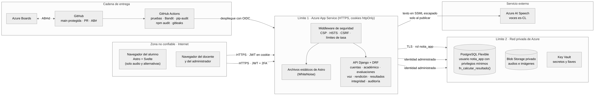

# NotIA · Plan de desarrollo

NotIA se construye en 6 fases repartidas en los sprints 4 a 9, con 27 pull requests más los de corrección de hallazgos. Cada PR corresponde a una tarea del backlog de Azure Boards y entra a `main` con el CI en verde y la aprobación de otro integrante. La especificación técnica está en `docs/ARQUITECTURA.md`.

## La aplicación en una página

NotIA es un sistema web de pruebas de alternativas para el colegio AulaConecta en el que la pregunta solo se escucha, para que no se pueda copiar y pegar en una herramienta de IA. El docente decide si cada alumno rinde la prueba NotIA o la prueba normal, con la pregunta escrita, para que nadie quede excluido.

### Quién la usa y para qué

| Rol | Qué hace en el sistema |
| --- | --- |
| Alumno | Elige la voz, escucha cada pregunta, responde o pasa antes de que se acabe el tiempo y ve su nota cuando el docente la publica. Puede avisar si ninguna voz le sirve o si necesita otra modalidad. |
| Docente | Crea y publica pruebas (los audios se generan al publicar), asigna la modalidad de cada alumno, revisa alertas e intentos, corrige preguntas y publica notas. |
| Administrador | Crea usuarios y cursos, registra el consentimiento de los apoderados, consulta la bitácora y atiende los derechos de los alumnos (exportar o anonimizar datos). |

### Cómo funciona una prueba NotIA

1. El alumno inicia sesión, elige la prueba asignada y escucha las voces de muestra para elegir una.
2. El servidor le presenta una pregunta a la vez: solo el audio, las alternativas y el tiempo restante. El texto de la pregunta y la respuesta correcta nunca llegan al navegador.
3. El reloj corre en el servidor. Si el alumno pasa una pregunta, esta vuelve al final con el tiempo que le quedaba; si se desconecta, el tiempo sigue corriendo.
4. Cada respuesta se guarda al enviarla. Al terminar, una función de PostgreSQL calcula la nota con la escala de 1,0 a 7,0 y exigencia del 60%.
5. Durante la prueba se registran eventos como salir de la pestaña o intentar copiar, solo para que el docente los revise, y se muestra una marca de agua con el nombre del alumno.

### Tecnología

- Backend: Django 5.2 con Django REST Framework, separado por apps (cuentas, académico, evaluaciones, voz, rendición, resultados, integridad y auditoría). Sin templates de Django.
- Frontend: Astro estático con componentes Svelte, servido por Django desde el mismo dominio que la API.
- Base de datos: PostgreSQL, con funciones almacenadas y sin triggers ni jobs.
- Voz: Azure AI Speech con voces de español de Chile.
- Nube: Azure App Service, Azure Database for PostgreSQL, Blob Storage privado y Key Vault.
- Trabajo: GitHub con `main` protegida, GitHub Actions como CI/CD y Azure Boards enlazado con AB#.

### Pilares de seguridad

- Login con Argon2id, JWT en cookies httpOnly, bloqueo tras 5 intentos fallidos y 2FA para docentes y administradores.
- Autorización por rol y por objeto en cada endpoint: nadie ve datos de otro alumno ni de otro curso.
- Bitácora de auditoría de solo inserción y CSP estricta, sin datos sensibles procesados en JavaScript.
- Ley 21.719: no se guarda RUT, fecha de nacimiento ni el motivo de la modalidad. Las cuentas de alumnos se activan solo con el consentimiento del apoderado registrado.
- Secretos en variables de entorno y Key Vault, nunca en el repositorio.

### Qué se evalúa en código y qué queda fuera

El ramo evalúa dos casos de uso programados: **CU-01 Iniciar sesión** y **CU-05 Rendir prueba NotIA**, que son las fases 1 y 2. El resto se construye por fases si alcanza el tiempo y, si no, queda documentado. Quedan fuera del proyecto el portal de notas, la asistencia, los informes para apoderados, la app móvil y el envío de correos.



## Fases y sprints

Las fases 1 y 2 son las que evalúa el ramo en código, así que van primero y tienen prioridad si el tiempo se acorta. La Sumativa 2 (25 de noviembre, semana 7) necesita código de las fases 0 a 2 para analizarlo, y la Sumativa 3 (semana 9) necesita el pipeline y el despliegue.

| Fase | Sprint | PRs | Qué queda funcionando | Criterio de término |
| --- | --- | --- | --- | --- |
| 0 · Base del proyecto | 4 | 3 | Backend, frontend y base de datos corriendo en local; CI con compuertas de seguridad | `docker compose up`, `runserver` y `npm run dev` funcionan; CI en verde; checks obligatorios en el ruleset |
| 1 · Inicio de sesión seguro | 5 | 6 | CU-01 a CU-04: login, bloqueo, 2FA, cierre de sesión, cambio de contraseña y bitácora | Las pruebas de RS-01 a RS-07 y RS-16 pasan; login en el navegador sin errores de CSP |
| 2 · Rendir prueba | 6 | 6 | CU-05 a CU-08: un alumno de la demo rinde en NotIA y otro en modalidad normal | Pruebas del motor de tiempo y de "sin texto en la API" pasan; prueba completa en el navegador |
| 3 · Panel docente | 7 y 8 | 6 | CU-09 a CU-14: crear, publicar, asignar, revisar alertas, reabrir y publicar notas | Un docente hace el ciclo completo sin tocar la base de datos |
| 4 · Panel de gestión | 8 | 3 | CU-15 a CU-17: usuarios, cursos, consentimientos, bitácora y derechos del alumno | No queda nada que requiera el admin de Django |
| 5 · Seguridad y despliegue | 7 y 9 | 3 + correcciones | Análisis del código para la Sumativa 2; despliegue en Azure y demostración del pipeline para la Sumativa 3 | Sin hallazgos altos abiertos; app en Azure; un PR bloqueado y otro aprobado |

Si el tiempo no alcanza, se recorta desde abajo: primero la fase 4, después la parte de alertas y resultados de la fase 3. Las fases 0, 1, 2 y 5 no se recortan.

## Cómo se trabaja cada PR

Cada PR es una rama corta asociada a una sola tarea de Boards. Lo trabaja con Claude Code el responsable de esa tarea en su computador, y lo revisa otro integrante. Así los tres quedan con commits y PR a su nombre, que es lo que el profe revisa en la defensa.

**Reglas de cada PR**

1. Rama desde `main` actualizada, con el nombre indicado en el plan (por ejemplo `fase1/login-api`).
2. Todos los commits del PR terminan en el AB# de su tarea. En el plan los commits aparecen sin el número; se agrega el ID que dio Boards.
3. Mensajes en español, en presente y con un solo cambio por commit, por ejemplo `Agrega bloqueo por intentos fallidos AB#23`.
4. Antes de abrir el PR, el responsable lo prueba en su navegador y ejecuta las pruebas.
5. El PR se integra solo con el CI en verde y la aprobación de otro integrante. Javiera, como Security Champion, revisa todo PR que toque login, permisos o datos personales.
6. Después del merge, la tarea pasa a Closed en Boards y se borra la rama.

**Frase para pedirle cada PR a Claude Code**

```text
Hagamos el PR 1.2 de docs/PLAN_DESARROLLO.md. Crea la rama fase1/login-api desde main y haz los commits en el orden indicado. Cada mensaje termina en AB#<número de la tarea>. Sigue docs/ARQUITECTURA.md. Al terminar, ejecuta las pruebas y los analizadores y muéstrame un resumen. No hagas push.
```

**Después de cada PR**

```powershell
git push -u origin fase1/login-api
```

Luego se abre el PR en GitHub con el título del plan y su AB#, se pide la revisión y, cuando esté aprobado, se integra con **Squash and merge** cuidando que el mensaje final mantenga el AB#.

## Fase 0 · Base del proyecto (Sprint 4)

Al final de esta fase cualquiera de los tres clona el repositorio y tiene todo corriendo en local, y cada PR pasa por pruebas y análisis de seguridad automáticos.

### PR 0.1 · Estructura del proyecto

Rama `fase0/estructura` · Tarea: Generar la base del proyecto con Claude Code (Fase 0) · Responsable: Ariel · Revisa: Jeremías

1. Agrega CLAUDE.md, docs/ARQUITECTURA.md y docs/PLAN_DESARROLLO.md
2. Crea el proyecto Django con settings separados por entorno
3. Crea las apps core, cuentas, academico, evaluaciones, voz, rendicion, resultados, integridad y auditoria, con el modelo Usuario propio definido antes de la primera migración
4. Crea el frontend Astro con Svelte y el proxy de desarrollo hacia la API
5. Agrega .gitignore, .editorconfig y backend/.env.example

### PR 0.2 · Base segura

Rama `fase0/base-segura` · Tarea: Variables de entorno, roles de BD con privilegios mínimos y cabeceras de seguridad · Responsable: Jeremías · Revisa: Javiera

1. Lee la configuración desde variables de entorno y falla si faltan en producción
2. Agrega docker-compose con PostgreSQL y script de roles notia_owner y notia_app
3. Agrega middleware de cabeceras de seguridad y CSP sin unsafe-inline
4. Agrega script de hashes de CSP para los scripts de Astro
5. Agrega comando generar_llaves
6. Configura manejo de errores genérico y logging sin datos sensibles

### PR 0.3 · CI con compuertas de seguridad

Rama `fase0/ci` · Tarea: CI con pruebas, Bandit, pip-audit, npm audit y gitleaks como checks obligatorios · Responsable: Javiera · Revisa: Ariel

1. Agrega workflow de CI con pruebas, ruff y Bandit para el backend
2. Agrega ESLint, astro check y build al CI del frontend
3. Agrega pip-audit, npm audit y gitleaks al CI
4. Agrega pre-commit, Dependabot y plantilla de PR
5. Agrega SECURITY.md y amplía el README con la instalación en Windows

Después del merge, Javiera agrega los trabajos del CI como checks obligatorios en el ruleset `proteger-main`.

## Fase 1 · Inicio de sesión seguro (Sprint 5)

Esta fase es uno de los dos casos de uso que evalúa el ramo (CU-01). La bitácora va primero porque el login escribe en ella desde el primer intento.

### PR 1.1 · Bitácora de auditoría

Rama `fase1/bitacora` · Tarea: Bitácora de auditoría de solo inserción · Responsable: Javiera · Revisa: Jeremías

1. Agrega el modelo RegistroAuditoria y el servicio para registrar eventos
2. Limita el rol notia_app a insertar y leer la bitácora
3. Agrega prueba de que la aplicación no puede modificar ni borrar registros

### PR 1.2 · API de login

Rama `fase1/login-api` · Tarea: API de login con Argon2id y JWT en cookies httpOnly · Responsable: Jeremías · Revisa: Javiera

1. Completa el modelo Usuario con roles y campos de bloqueo, sesión y consentimiento
2. Configura Argon2id y la política de contraseñas por rol
3. Agrega autenticación JWT desde cookies httpOnly con verificación CSRF
4. Agrega los endpoints csrf, login, refresh y yo
5. Bloquea el ingreso de alumnos sin consentimiento registrado
6. Agrega pruebas de login y de los atributos de las cookies

### PR 1.3 · Bloqueo y límite de intentos

Rama `fase1/bloqueo` · Tarea: Bloqueo por intentos, límite por IP y mensajes sin enumeración · Responsable: Javiera · Revisa: Jeremías

1. Bloquea la cuenta 15 minutos tras 5 intentos fallidos
2. Agrega límite de 10 intentos de login por minuto por IP
3. Unifica los mensajes y el tiempo de respuesta para no revelar si el correo existe
4. Registra intentos fallidos y bloqueos en la bitácora
5. Agrega pruebas de bloqueo, desbloqueo y enumeración

### PR 1.4 · Sesiones y contraseñas

Rama `fase1/sesiones` · Tarea: Logout, cambio de contraseña e invalidación de sesiones · Responsable: Jeremías · Revisa: Ariel

1. Agrega logout con lista negra del token de refresco
2. Obliga a cambiar la contraseña temporal en el primer ingreso
3. Invalida todas las sesiones al cambiar la contraseña
4. Agrega pruebas de logout, rotación de tokens y sesiones invalidadas

### PR 1.5 · Segundo factor (2FA)

Rama `fase1/2fa` · Tareas: 2FA TOTP con secreto cifrado y códigos de recuperación (Jeremías, commits 1 a 3) y Pruebas de 2FA (Javiera, commit 4) · Revisa: Ariel

1. Agrega el enrolamiento TOTP con QR generado en el servidor
2. Cifra el secreto TOTP con Fernet y rechaza códigos repetidos
3. Agrega la verificación con ticket temporal y los códigos de recuperación
4. Agrega pruebas de 2FA con código válido, repetido y vencido

### PR 1.6 · Pantallas de acceso

Rama `fase1/pantallas-login` · Tarea: Pantalla de inicio de sesión · Responsable: Ariel · Revisa: Javiera

1. Agrega la identidad visual: colores, tipografías y componentes base
2. Agrega el cliente de la API con CSRF y renovación de sesión
3. Agrega la pantalla de inicio de sesión con el paso de 2FA
4. Agrega las pantallas de cambio de contraseña y activación de 2FA

Antes del commit 1, Claude Code presenta la propuesta de diseño (paleta, tipografías y un boceto de la pantalla de prueba). El equipo la aprueba antes de seguir.

## Fase 2 · Rendir prueba (Sprint 6)

Es el segundo caso de uso evaluado (CU-05) y el corazón de NotIA. Antes de empezar, Jeremías tiene que haber creado el recurso de Azure AI Speech y repartido la llave a los `.env` de cada uno (Parte 5.1 de la guía).

### PR 2.1 · Modelos académicos y de evaluaciones

Rama `fase2/modelos` · Tarea: Motor de rendición con el tiempo controlado por el servidor · Responsable: Jeremías · Revisa: Ariel

1. Agrega Curso, CursoDocente y Matricula
2. Agrega Evaluacion, Pregunta y Alternativa con sus restricciones
3. Agrega AsignacionPrueba sin campo de motivo
4. Agrega pruebas de las restricciones (una sola alternativa correcta, tiempos entre 10 y 300 segundos)

### PR 2.2 · Servicio de voz

Rama `fase2/voz` · Tarea: Integrar Azure AI Speech con SSML escapado y llave fuera del código · Responsable: Jeremías · Revisa: Javiera

1. Agrega la interfaz ProveedorVoz y un proveedor de prueba sin red
2. Agrega el proveedor de Azure con SSML escapado, tiempo de espera y reintentos
3. Agrega AudioPregunta, audios de muestra y almacenamiento privado
4. Agrega pruebas de escape de SSML y de respuestas inválidas de Azure

### PR 2.3 · Motor de rendición

Rama `fase2/motor` · Tarea: Motor de rendición con el tiempo controlado por el servidor · Responsable: Jeremías · Revisa: Javiera

1. Agrega Intento y Respuesta con orden de preguntas y alternativas barajado por alumno
2. Agrega los endpoints iniciar, actual, responder y pasar con bloqueo de fila
3. Agrega la sincronización por tiempo agotado y por fin de la ventana de la prueba
4. Agrega la función SQL fn_calcular_resultado y el modelo Resultado
5. Agrega pruebas del motor con tiempo simulado: pasar, tiempo agotado, desconexión y doble respuesta

### PR 2.4 · API del alumno sin fugas

Rama `fase2/api-alumno` · Tareas: Modalidad normal con la pregunta escrita (Jeremías, commit 1) y Verificar que la API nunca envía el texto ni la respuesta correcta (Javiera, commits 2 a 4) · Revisa: Ariel

1. Entrega el texto de la pregunta solo en modalidad normal
2. Restringe el audio y la imagen a la pregunta en curso del propio alumno
3. Agrega una prueba que recorre una evaluación completa y busca el texto o la respuesta correcta en cada respuesta de la API
4. Agrega pruebas de acceso a intentos de otro alumno

### PR 2.5 · Integridad y avisos

Rama `fase2/integridad` · Tarea: Avisos del alumno al docente sin texto libre · Responsable: Ariel · Revisa: Javiera

1. Agrega EventoIntegridad con una lista cerrada de tipos y límite de frecuencia
2. Agrega SolicitudAlumno sin campo de texto libre
3. Agrega pruebas de límite de eventos y de tipos no permitidos

### PR 2.6 · Pantallas del alumno

Rama `fase2/pantallas-alumno` · Tareas: Pantalla de preparación con muestras de voz (commits 1 y 2) y Pantalla de prueba con audio, temporizador y marca de agua (commits 3 a 7) · Responsable: Ariel · Revisa: Jeremías

1. Agrega la lista de pruebas asignadas al alumno
2. Agrega la pantalla de preparación con muestras de voz y botones de aviso
3. Agrega la pantalla de prueba con audio, alternativas y selección con teclado
4. Agrega el temporizador sincronizado con el servidor
5. Agrega la marca de agua y el registro de eventos de integridad
6. Agrega las pantallas de fin y de resultados
7. Agrega el comando cargar_demo con una prueba publicada de 5 preguntas

Con este PR integrado se cumple el criterio de la fase: un alumno de la demo rinde en NotIA y otro en modalidad normal, de principio a fin, en el navegador.

## Fase 3 · Panel docente (Sprints 7 y 8)

Con esta fase el docente deja de depender de `cargar_demo`: crea sus pruebas, las publica, asigna modalidades y cierra la evaluación con notas. Los PR 3.1 a 3.4 van en el Sprint 7 y los PR 3.5 y 3.6 en el Sprint 8.

### PR 3.1 · API de evaluaciones

Rama `fase3/evaluaciones-api` · Tarea: API y editor de evaluaciones con publicación de audios · Responsable: Jeremías · Revisa: Javiera

1. Agrega la creación y edición de evaluaciones, preguntas y alternativas en borrador
2. Valida la evaluación completa antes de publicarla
3. Agrega la publicación con generación de audios en paralelo
4. Agrega nuevas versiones de evaluaciones ya publicadas
5. Agrega pruebas de edición bloqueada en evaluaciones publicadas

### PR 3.2 · Imágenes seguras

Rama `fase3/imagenes` · Tarea: Subida de imágenes validada y sin metadatos · Responsable: Javiera · Revisa: Jeremías

1. Valida el tipo real, el peso y las dimensiones de las imágenes
2. Reconvierte las imágenes a WebP y elimina los metadatos
3. Agrega la subida y la entrega privada de imágenes de preguntas
4. Agrega pruebas con extensión falsa, archivo políglota, imagen enorme y EXIF

### PR 3.3 · Editor de evaluaciones

Rama `fase3/editor` · Tarea: API y editor de evaluaciones con publicación de audios · Responsable: Jeremías · Revisa: Ariel

1. Agrega la lista de evaluaciones por curso
2. Agrega el editor de preguntas con escucha previa del audio
3. Agrega la publicación y el versionado desde el editor

### PR 3.4 · Asignación de modalidad

Rama `fase3/asignacion` · Tareas: Asignación de modalidad sin guardar el motivo (Ariel, commits 1 y 2) y Pruebas de autorización por objeto entre docentes (Javiera, commit 3) · Revisa: Jeremías

1. Agrega el endpoint de asignaciones por curso sin campo de motivo
2. Agrega la pantalla de asignación de modalidad
3. Agrega pruebas de acceso de un docente a cursos y evaluaciones ajenas

### PR 3.5 · Alertas y reapertura

Rama `fase3/alertas` · Tarea: Alertas del docente y reapertura de intentos con registro · Responsable: Jeremías · Revisa: Javiera

1. Agrega el resumen de alertas y el detalle de cada intento con sus eventos
2. Agrega la reapertura de preguntas no respondidas registrada en la bitácora
3. Agrega las pantallas de alertas y de detalle de intento
4. Agrega pruebas de reapertura

### PR 3.6 · Resultados y notas

Rama `fase3/resultados` · Tareas: Resultados, corrección de preguntas y publicación de notas (Ariel, commits 1 a 4) y Exportación CSV protegida contra inyección de fórmulas (Javiera, commit 5) · Revisa: Jeremías

1. Agrega resultados por alumno y por pregunta
2. Agrega la anulación y corrección de preguntas con recálculo de notas
3. Agrega marcar sin nota y publicar notas
4. Agrega la pantalla de resultados
5. Agrega la exportación CSV protegida contra inyección de fórmulas

## Fase 4 · Panel de gestión (Sprint 8)

Con esta fase el colegio puede administrar el sistema sin tocar la base de datos ni el admin de Django, y cumplir los derechos de los alumnos según la Ley 21.719.

### PR 4.1 · Usuarios, cursos y consentimientos

Rama `fase4/usuarios` · Tarea: Gestión de usuarios y cursos con registro de consentimiento · Responsable: Jeremías · Revisa: Javiera

1. Agrega la creación de usuarios con contraseña temporal mostrada una sola vez
2. Agrega el registro del consentimiento del apoderado
3. Agrega desbloquear cuentas, restablecer contraseñas y reiniciar el 2FA
4. Agrega cursos, matrículas y docentes por curso
5. Agrega la importación de alumnos por CSV validado
6. Agrega las pantallas de usuarios y cursos

### PR 4.2 · Consulta de la bitácora

Rama `fase4/bitacora` · Tarea: Consulta de la bitácora con filtros · Responsable: Ariel · Revisa: Javiera

1. Agrega la consulta de la bitácora con filtros por fecha, acción y usuario
2. Agrega la pantalla de bitácora

### PR 4.3 · Privacidad y derechos del alumno

Rama `fase4/privacidad` · Tareas: Exportación, anonimización y purga de datos (commits 1 a 3) y Registro de tratamientos y aviso de privacidad (commits 4 y 5) · Responsable: Javiera · Revisa: Ariel

1. Agrega la exportación de los datos de un alumno en JSON
2. Agrega la anonimización de alumnos
3. Agrega la purga de eventos de integridad vencidos
4. Agrega docs/PRIVACIDAD.md con el registro de tratamientos
5. Agrega la pantalla de aviso de privacidad

## Fase 5 · Análisis de seguridad y despliegue (Sprints 7 y 9)

Esta fase tiene dos momentos. En el Sprint 7 se analiza el código de las fases 0 a 2 para la Sumativa 2. En el Sprint 9 se despliega en Azure y se demuestra el pipeline para la Sumativa 3.

### PR 5.1 · Análisis del código (Sprint 7)

Rama `seguridad/analisis` · Tarea: Analizar el código, clasificar hallazgos y registrarlos como Bug · Responsable: Javiera · Revisa: Jeremías

1. Agrega Semgrep con reglas de Django y OWASP al CI
2. Agrega docs/HALLAZGOS.md con cada hallazgo clasificado como verdadero o falso positivo y su justificación

Cada hallazgo verdadero se registra a mano en Boards como **Bug**, con su severidad, bajo la tarea de análisis.

### PR de corrección (Sprint 7)

Rama `fix/<nombre-corto>` por hallazgo · Tarea: Corregir los hallazgos de severidad alta, con el AB# del **Bug** · Responsable: Jeremías · Revisa: Javiera

1. Corrige el hallazgo
2. Agrega la prueba que demuestra que ya no ocurre

Después del merge, Javiera actualiza el hallazgo en HALLAZGOS.md como verificado y cierra el Bug.

### PR 5.2 · Despliegue en Azure (Sprint 9)

Rama `despliegue/azure` · Tarea: Despliegue con OIDC y aprobación manual · Responsable: Ariel · Revisa: Javiera

Antes de este PR, Jeremías crea a mano la base de datos, Blob Storage, Key Vault y App Service (Partes 5.2 a 5.5 de la guía).

1. Ajusta la configuración de producción para Azure con identidad administrada
2. Agrega el comando de arranque con migraciones y archivos estáticos
3. Activa el workflow de despliegue con OIDC y aprobación manual
4. Agrega la guía de despliegue al README

### PR 5.3 · Prueba de carga (Sprint 9)

Rama `pruebas/carga` · Tarea: Prueba de carga y alerta de costos · Responsable: Ariel · Revisa: Jeremías

1. Agrega el escenario de Locust con 400 alumnos rindiendo a la vez
2. Agrega los resultados de la prueba de carga a la documentación

### Demostración del pipeline (Sprint 9)

Tarea: Demostrar un cambio bloqueado y uno aprobado · Responsable: Javiera

1. Abre un PR desde la rama `demo/cambio-inseguro` con un error de seguridad a propósito, por ejemplo una consulta SQL armada concatenando texto, que Bandit detecta. El CI debe ponerse en rojo y GitHub debe impedir el merge.
2. Graba la pantalla o saca capturas, y cierra ese PR sin integrarlo.
3. Muestra como contraste un PR correcto que pase todas las compuertas y se integre.

Al terminar la fase, Ariel crea la versión `v1.0.0` en GitHub (**Releases** → **Draft a new release**) para marcar lo que se presentó en la Sumativa 3.
